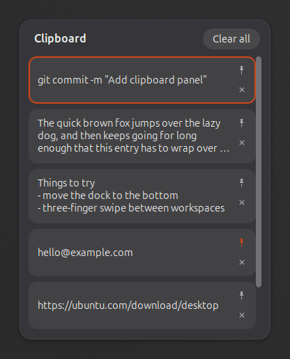
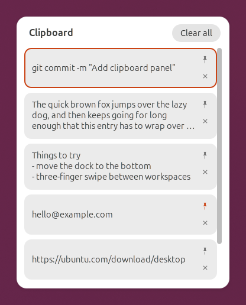

# Clipboard Panel

Clipboard history for GNOME Shell, laid out like the Windows clipboard panel:
press **Super+V**, a panel opens at the pointer, and clicking an entry pastes it
into the window you were working in.

It takes its background, borders, buttons and accent colour from the shell
theme, so on Ubuntu it matches Yaru in both light and dark.

| Dark | Light |
| --- | --- |
|  |  |

## Features

- Opens next to the pointer, and flips or shifts to stay on screen.
- Click an entry, or select it and press Enter, to paste it. Terminals get
  Ctrl+Shift+V; everything else gets Ctrl+V.
- Pin entries you reuse. Pinned entries survive "Clear all" and logging out.
- Unpinned history lasts until you log out, as on Windows.
- Skips anything a password manager marks as secret.
- Text only: copied images and files are not recorded.

## Keys

| Key | Action |
| --- | --- |
| Super+V | Open or close the panel |
| Up / Down, Tab / Shift+Tab | Move the selection |
| Enter | Paste the selected entry |
| Delete | Remove the selected entry |
| Esc | Close |

## Requirements

GNOME Shell 50. Developed and tested on Ubuntu 26.04.

## Install

```sh
git clone https://github.com/TheRealFaruhaan/clipboard-panel.git
cd clipboard-panel
make install
```

Log out and back in, then enable it:

```sh
gnome-extensions enable clipboard-panel@farhan.local
```

Without `make`, the same two steps are:

```sh
gnome-extensions pack --force
gnome-extensions install --force clipboard-panel@farhan.local.shell-extension.zip
```

### The Super+V shortcut

GNOME uses Super+V for the notification list by default. While this extension
is enabled it takes Super+V off that action, and gives it back when disabled.
Super+M still opens the notification list.

## Settings

There is no settings window yet. The options can be changed from a terminal:

```sh
SCHEMAS=~/.local/share/gnome-shell/extensions/clipboard-panel@farhan.local/schemas
KEY="gsettings --schemadir $SCHEMAS set org.gnome.shell.extensions.clipboard-panel"

$KEY history-size 50            # unpinned entries to keep (5-100, default 25)
$KEY paste-on-select false      # only copy the chosen entry, do not paste it
$KEY toggle-panel "['<Super><Shift>v']"   # change the shortcut
```

A new shortcut takes effect the next time the extension is enabled.

## Where data is kept

| What | Where |
| --- | --- |
| History for this login | `$XDG_RUNTIME_DIR/clipboard-panel-history.json` |
| Pinned entries | `~/.local/share/clipboard-panel/pinned.json` |

Both files are readable only by you.

## Uninstall

```sh
make uninstall
rm -r ~/.local/share/clipboard-panel
```

## License

MIT. See [LICENSE](LICENSE).
